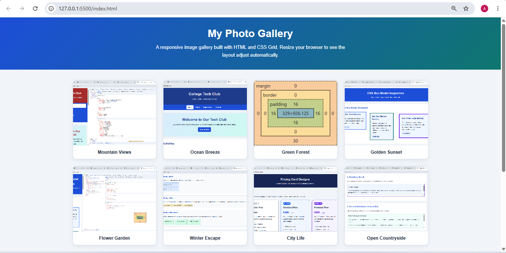
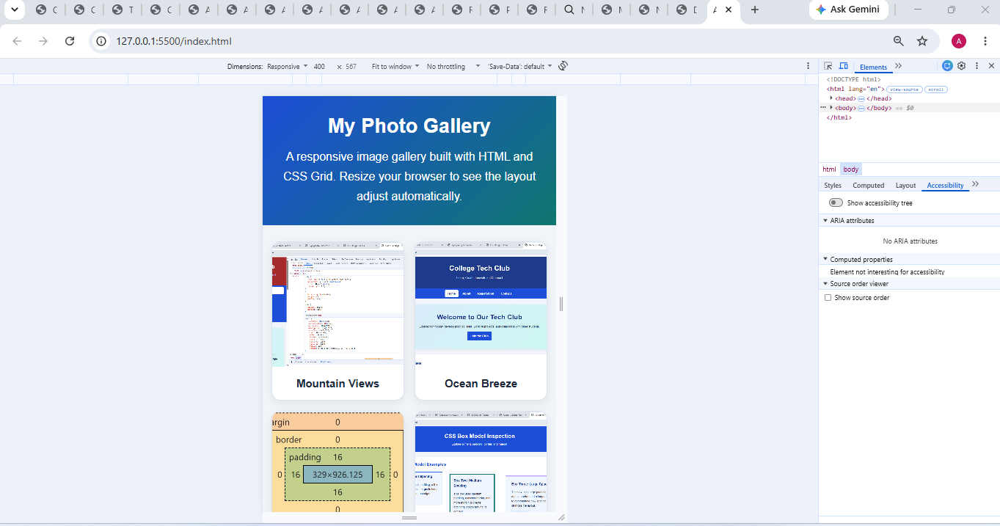

# Assignment 8.2 — Auto-Responsive Image Gallery

Aim: To create a responsive photo gallery using CSS Grid, `auto-fit`, `minmax()`, `object-fit`, and `gap`.


## 1. How auto-responsive Grid works

The most important line is:

```
grid-template-columns: repeat(auto-fit, minmax(230px, 1fr));
```

- `repeat()` repeats the column pattern.
- `auto-fit` fits as many columns as possible into the available space.
- `minmax(230px, 1fr)` keeps each column at least 230 pixels wide when space allows, while allowing columns to expand equally.
- `gap: 22px` creates consistent space between gallery items.
- `width: 100%` makes each image fill its gallery item.
- `object-fit: cover` fills the image area while preserving its proportions, cropping excess edges when necessary.

The mobile media query reduces the minimum column width to 150 pixels, allowing smaller screens to fit the gallery more comfortably.


## 2. Screenshot and submission


## Screenshot 1 — Desktop



## Screenshot 2 — Mobile


## Result:
 An auto-responsive image gallery has been created using CSS Grid. Its columns adjust automatically to the available screen width, with consistent spacing, image sizing, and captions.